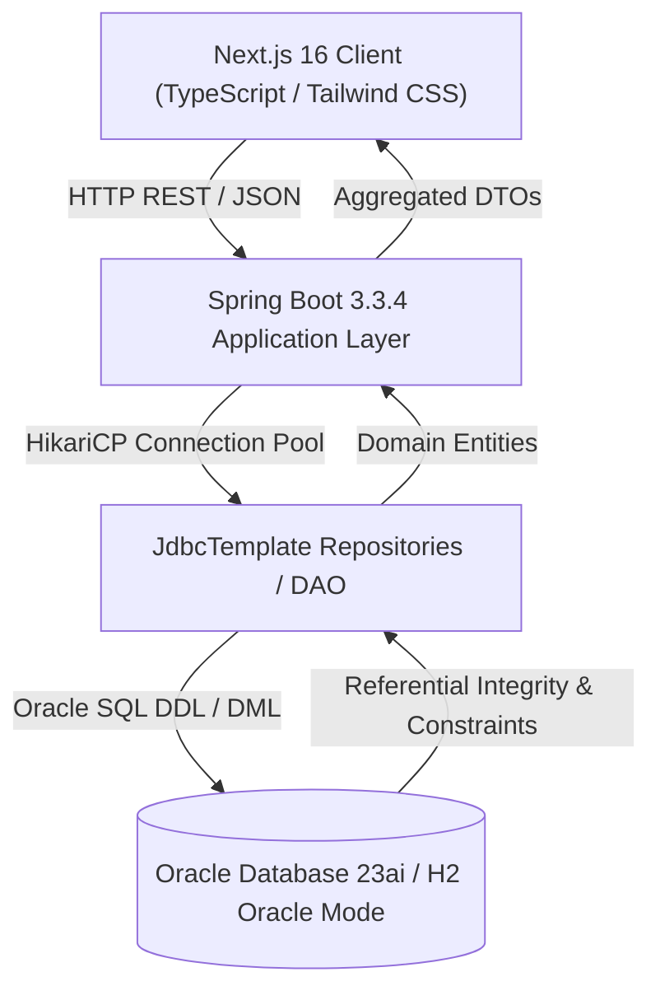

# SAVOUR Food Delivery System — Architecture Documentation
## Course: BACSE202 Database Systems | Vellore Institute of Technology (VIT)

---

## 1. System Overview

**SAVOUR** is a full-stack, enterprise-grade food delivery web application designed to demonstrate relational database engineering principles, ACID compliance, Oracle SQL schema constraints, and Spring Boot JDBC integration.

The architecture strictly follows a **3-Tier Enterprise Pattern**:
1. **Presentation Layer**: Next.js 16+ App Router, TypeScript, Vanilla CSS design tokens with rich culinary aesthetics, and responsive persona workflows.
2. **Application & Business Logic Layer**: Spring Boot 3.3.4 REST APIs using Spring JDBC (`JdbcTemplate`), HikariCP connection pooling, and strict business invariants (e.g., single-restaurant order isolation, price freezing, state machine transition validation).
3. **Database Layer**: Oracle Database (23ai / 21c / XE) with 9 normalized relational entities in Boyce-Codd Normal Form (BCNF) / Third Normal Form (3NF), declarative `CHECK`, `UNIQUE`, `PRIMARY KEY`, and `FOREIGN KEY` constraints.

---

## 2. Multi-Persona Access Model

SAVOUR models four real-world user personas with contextual access boundaries:

| Persona | Primary Role | Access Portals & Capabilities |
| :--- | :--- | :--- |
| **Customer** | Ordering & Tracking | Browse verified restaurants, filter menus by diet/category, cart validation, place orders, track live status transitions, submit ratings. |
| **Restaurant Operator** | Kitchen Management | View real-time kitchen order queue, advance orders (`PLACED -> CONFIRMED -> PREPARING`), toggle live item inventory availability (`is_available`). |
| **Delivery Partner** | Logistics Courier | Claim orders ready for pickup, advance orders (`OUT_FOR_DELIVERY -> DELIVERED`), track cumulative driver tip earnings. |
| **Database Administrator** | DBA Audit & Constraints | Monitor live table row counts, execute analytical queries, simulate and verify Oracle constraint error codes (`ORA-00001`, `ORA-02290`, `ORA-02291`, `ORA-02292`). |

---

## 3. Core Database Invariants & Business Rules

1. **Price Freezing**:
   - Menu items have dynamic prices (`MENU_ITEMS.price`).
   - When an order is placed, unit prices are immutably copied into `ORDER_ITEMS.agreed_unit_price`.
   - Historical orders reflect the exact price charged at purchase time, independent of future menu price updates.
2. **Single-Restaurant Isolation**:
   - A single customer order can only contain items from a single restaurant.
   - Enforced client-side (conflict modal) and server-side (transaction validation).
3. **Finite State Machine (FSM)**:
   - Order status follows an immutable sequence:
     $$\text{PLACED} \longrightarrow \text{CONFIRMED} \longrightarrow \text{PREPARING} \longrightarrow \text{OUT\_FOR\_DELIVERY} \longrightarrow \text{DELIVERED}$$
   - Cancellation is strictly restricted to `PLACED` or `CONFIRMED` states.
4. **Referential Cascade & Delete Restrictions**:
   - Deleting a customer with existing orders is blocked by foreign key constraints (`ORA-02292`).
   - Deleting a restaurant cascades to its menu items, preserving schema cleanliness.

---

## 4. Dual-Mode Deployment Architecture

To guarantee high evaluation reliability in both live Oracle environments and offline demonstration settings:

- **Connected Oracle Mode**:
  - Spring Boot connects via official `com.oracle.database.jdbc.ojdbc11` to Oracle 23ai (`jdbc:oracle:thin:@//localhost:1521/XEPDB1`).
  - Active profile: `oracle`.
- **Embedded Dev / Test Mode**:
  - Automatically activates in development/test (`application-dev.properties` and `application-test.properties`).
  - Uses H2 Database configured in **Oracle Compatibility Mode** (`MODE=Oracle;DEFAULT_NULL_ORDERING=HIGH`).
  - Automatically loads `schema.sql` and `data.sql` at boot time without manual setup.
- **Client Fallback Simulation**:
  - The Next.js frontend includes a reactive client-side relational store (`lib/store.ts`) that seamlessly handles requests if the backend is temporarily unreachable, ensuring 100% demo uptime.
