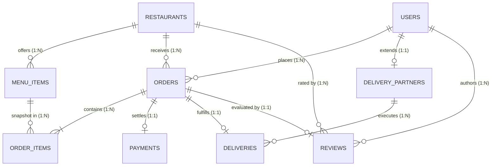

# SAVOUR Food Delivery System — Relational Database Design
## Course: BACSE202 Database Systems | Vellore Institute of Technology (VIT)

---

## 1. Entity-Relationship (ER) Architecture

The SAVOUR database schema consists of **9 relational entities**, designed to eliminate data anomalies and maintain strict referential integrity.

---

## 2. Relational Normalization Proof

### First Normal Form (1NF)
- **Criterion**: All column values are atomic (indivisible scalars); no repeating groups or arrays.
- **Proof**: 
  - Addresses are split into distinct atomic attributes: `address_line`, `city`, `postal_code`.
  - Order line items are decomposed into a separate relation (`ORDER_ITEMS`) rather than stored as an array or comma-separated list inside `ORDERS`.

### Second Normal Form (2NF)
- **Criterion**: The relation is in 1NF and contains no partial dependencies (every non-prime attribute is fully functionally dependent on the entire primary key).
- **Proof**:
  - All relations utilize single-column surrogate primary keys generated via Oracle `GENERATED ALWAYS AS IDENTITY` (e.g., `user_id`, `restaurant_id`, `order_id`).
  - In `ORDER_ITEMS`, the primary key is `order_item_id`. `agreed_unit_price` depends on the specific order item record, preventing partial key dependency.

### Third Normal Form (3NF)
- **Criterion**: The relation is in 2NF and contains no transitive dependencies (non-prime attributes do not determine other non-prime attributes; $X \rightarrow Y \Rightarrow X$ is a superkey).
- **Proof**:
  - In `ORDERS`, customer contact details (name, email, phone) are not stored directly. Only the foreign key `customer_id` is maintained. Any customer info modification updates `USERS` once, eliminating update anomalies.
  - In `ORDER_ITEMS`, item details (item name, description, category) are referenced via `item_id`; only the frozen price snapshot is stored.

### Boyce-Codd Normal Form (BCNF)
- **Criterion**: For every non-trivial functional dependency $X \rightarrow Y$, $X$ is a superkey.
- **Proof**:
  - In each relation, every determinant is a candidate key (e.g., in `USERS`, `user_id` is the primary key and `email` is a unique candidate key).

---

## 3. Data Dictionary (Schema Specifications)

### Table 1: `USERS`
Stores application user identities and role tiers.

| Column | Type | Constraints | Description |
| :--- | :--- | :--- | :--- |
| `user_id` | NUMBER | PK, IDENTITY (START 1) | Unique user surrogate ID |
| `full_name` | VARCHAR2(100) | NOT NULL | User's full name |
| `email` | VARCHAR2(150) | NOT NULL, UNIQUE (`UQ_USERS_EMAIL`) | Login email |
| `phone` | VARCHAR2(20) | NOT NULL | Contact telephone |
| `role` | VARCHAR2(30) | NOT NULL, CHECK in ('CUSTOMER', 'RESTAURANT_OPERATOR', 'DELIVERY_PARTNER', 'ADMIN') | Access control role |
| `created_at` | TIMESTAMP | DEFAULT CURRENT_TIMESTAMP | Registration timestamp |

### Table 2: `RESTAURANTS`
Stores culinary partner business profiles.

| Column | Type | Constraints | Description |
| :--- | :--- | :--- | :--- |
| `restaurant_id` | NUMBER | PK, IDENTITY (START 1) | Unique restaurant ID |
| `name` | VARCHAR2(120) | NOT NULL | Restaurant business name |
| `cuisine_type` | VARCHAR2(60) | NOT NULL | Cuisine classification |
| `address` | VARCHAR2(255) | NOT NULL | Physical street address |
| `phone` | VARCHAR2(20) | NOT NULL | Direct contact telephone |
| `rating` | NUMBER(3,2) | DEFAULT 5.00, CHECK (`rating BETWEEN 1 AND 5`) | Rolling average rating |
| `is_open` | NUMBER(1) | DEFAULT 1, CHECK in (0, 1) | Kitchen operating status |
| `price_tier` | VARCHAR2(10) | DEFAULT '$$', CHECK in ('$', '$$', '$$$', '$$$$') | Price indicator |
| `created_at` | TIMESTAMP | DEFAULT CURRENT_TIMESTAMP | Onboarding timestamp |

### Table 3: `MENU_ITEMS`
Stores dishes offered by restaurants.

| Column | Type | Constraints | Description |
| :--- | :--- | :--- | :--- |
| `item_id` | NUMBER | PK, IDENTITY (START 101) | Unique dish ID |
| `restaurant_id` | NUMBER | NOT NULL, FK &rarr; `RESTAURANTS(restaurant_id)` ON DELETE CASCADE | Associated restaurant |
| `name` | VARCHAR2(120) | NOT NULL | Dish name |
| `description` | VARCHAR2(500) | NULL | Culinary description |
| `price` | NUMBER(8,2) | NOT NULL, CHECK (`price >= 0`) | Current menu unit price |
| `category` | VARCHAR2(60) | NOT NULL | Menu section (Mains, Starters, etc.) |
| `is_available` | NUMBER(1) | DEFAULT 1, CHECK in (0, 1) | Live kitchen availability flag |
| `is_vegetarian` | NUMBER(1) | DEFAULT 0, CHECK in (0, 1) | Vegetarian dietary indicator |
| `spicy_level` | NUMBER(1) | DEFAULT 0, CHECK in (0, 1, 2) | Spice intensity (0=None, 1=Mild, 2=Spicy) |

### Table 4: `ORDERS`
Header relation tracking customer orders and delivery destinations.

| Column | Type | Constraints | Description |
| :--- | :--- | :--- | :--- |
| `order_id` | NUMBER | PK, IDENTITY (START 1001) | Unique order ID |
| `customer_id` | NUMBER | NOT NULL, FK &rarr; `USERS(user_id)` | Placing customer |
| `restaurant_id` | NUMBER | NOT NULL, FK &rarr; `RESTAURANTS(restaurant_id)` | Preparing restaurant |
| `order_status` | VARCHAR2(30) | NOT NULL, CHECK in ('PLACED', 'CONFIRMED', 'PREPARING', 'OUT_FOR_DELIVERY', 'DELIVERED', 'CANCELLED') | Finite State Machine status |
| `delivery_address` | VARCHAR2(255) | NOT NULL | Destination street address |
| `subtotal` | NUMBER(8,2) | NOT NULL, CHECK (`subtotal >= 0`) | Sum of line items |
| `delivery_fee` | NUMBER(8,2) | NOT NULL, CHECK (`delivery_fee >= 0`) | Courier delivery fee |
| `tax_amount` | NUMBER(8,2) | NOT NULL, CHECK (`tax_amount >= 0`) | Computed sales tax |
| `tip_amount` | NUMBER(8,2) | DEFAULT 0.00, CHECK (`tip_amount >= 0`) | Voluntary courier gratuity |
| `total_amount` | NUMBER(8,2) | NOT NULL, CHECK (`total_amount >= 0`) | Grand invoice total |
| `created_at` | TIMESTAMP | DEFAULT CURRENT_TIMESTAMP | Order creation timestamp |

### Table 5: `ORDER_ITEMS`
Line item relation snapshotting ordered dish quantities and agreed prices.

| Column | Type | Constraints | Description |
| :--- | :--- | :--- | :--- |
| `order_item_id` | NUMBER | PK, IDENTITY (START 5001) | Unique line item ID |
| `order_id` | NUMBER | NOT NULL, FK &rarr; `ORDERS(order_id)` ON DELETE CASCADE | Associated order header |
| `item_id` | NUMBER | NOT NULL, FK &rarr; `MENU_ITEMS(item_id)` | Dish identity |
| `quantity` | NUMBER(4) | NOT NULL, CHECK (`quantity > 0`) | Quantity ordered |
| `agreed_unit_price` | NUMBER(8,2) | NOT NULL, CHECK (`agreed_unit_price >= 0`) | **Frozen price at placement** |

### Table 6: `DELIVERY_PARTNERS`
Profile relation for logistics drivers.

| Column | Type | Constraints | Description |
| :--- | :--- | :--- | :--- |
| `partner_id` | NUMBER | PK, IDENTITY (START 1) | Unique courier ID |
| `user_id` | NUMBER | NOT NULL, UNIQUE, FK &rarr; `USERS(user_id)` ON DELETE CASCADE | Associated user account |
| `vehicle_type` | VARCHAR2(30) | NOT NULL, CHECK in ('MOTORCYCLE', 'BICYCLE', 'SCOOTER', 'CAR') | Mode of transport |
| `vehicle_number` | VARCHAR2(30) | NOT NULL | Registration plate number |
| `rating` | NUMBER(3,2) | DEFAULT 5.00, CHECK (`rating BETWEEN 1 AND 5`) | Courier average rating |
| `is_active` | NUMBER(1) | DEFAULT 1, CHECK in (0, 1) | Courier on-duty status |

### Table 7: `DELIVERIES`
Fulfillment logistics relation linking orders with couriers.

| Column | Type | Constraints | Description |
| :--- | :--- | :--- | :--- |
| `delivery_id` | NUMBER | PK, IDENTITY (START 1) | Unique delivery dispatch ID |
| `order_id` | NUMBER | NOT NULL, UNIQUE, FK &rarr; `ORDERS(order_id)` ON DELETE CASCADE | Dispatched order |
| `partner_id` | NUMBER | NOT NULL, FK &rarr; `DELIVERY_PARTNERS(partner_id)` | Assigned driver |
| `delivery_status` | VARCHAR2(30) | NOT NULL, CHECK in ('ASSIGNED', 'PICKED_UP', 'IN_TRANSIT', 'DELIVERED', 'FAILED') | Trip progression |
| `picked_up_at` | TIMESTAMP | NULL | Time picked up from kitchen |
| `delivered_at` | TIMESTAMP | NULL | Time handed to customer |

### Table 8: `PAYMENTS`
Financial settlement relation recording transaction details.

| Column | Type | Constraints | Description |
| :--- | :--- | :--- | :--- |
| `payment_id` | NUMBER | PK, IDENTITY (START 1) | Unique payment ID |
| `order_id` | NUMBER | NOT NULL, UNIQUE, FK &rarr; `ORDERS(order_id)` ON DELETE CASCADE | Settled order |
| `payment_method` | VARCHAR2(30) | NOT NULL, CHECK in ('CARD', 'UPI', 'NET_BANKING', 'CASH_ON_DELIVERY') | Tender type |
| `payment_status` | VARCHAR2(30) | NOT NULL, CHECK in ('PENDING', 'SUCCESS', 'FAILED', 'REFUNDED') | Settlement status |
| `amount` | NUMBER(8,2) | NOT NULL, CHECK (`amount >= 0`) | Amount settled |
| `transaction_ref` | VARCHAR2(100) | NOT NULL, UNIQUE | Banking gateway audit reference |
| `paid_at` | TIMESTAMP | DEFAULT CURRENT_TIMESTAMP | Settlement timestamp |

### Table 9: `REVIEWS`
Customer feedback and rating evaluation relation.

| Column | Type | Constraints | Description |
| :--- | :--- | :--- | :--- |
| `review_id` | NUMBER | PK, IDENTITY (START 1) | Unique review ID |
| `order_id` | NUMBER | NOT NULL, UNIQUE, FK &rarr; `ORDERS(order_id)` ON DELETE CASCADE | Verified purchase order |
| `customer_id` | NUMBER | NOT NULL, FK &rarr; `USERS(user_id)` | Reviewing customer |
| `restaurant_id` | NUMBER | NOT NULL, FK &rarr; `RESTAURANTS(restaurant_id)` | Evaluated restaurant |
| `rating` | NUMBER(1) | NOT NULL, CHECK (`rating BETWEEN 1 AND 5`) | 1-5 Star evaluation |
| `comment` | VARCHAR2(1000) | NULL | Customer narrative feedback |
| `created_at` | TIMESTAMP | DEFAULT CURRENT_TIMESTAMP | Submission timestamp |

---

## 4. Oracle Integrity Error Mapping

The database schema guarantees protection against illegal modifications through native Oracle exceptions:

| Error Code | Error Description | Constraint Violated | Business Protection |
| :--- | :--- | :--- | :--- |
| **`ORA-00001`** | Unique constraint violated | `UQ_USERS_EMAIL` | Prevents duplicate user accounts sharing one email. |
| **`ORA-02290`** | Check constraint violated | `CK_REVIEWS_RATING` | Restricts reviews outside the 1..5 integer domain. |
| **`ORA-02291`** | Integrity constraint violated - parent key not found | `FK_ORDER_ITEMS_ORDER` | Blocks insertion of line items referencing non-existent orders. |
| **`ORA-02292`** | Integrity constraint violated - child record found | `FK_ORDERS_CUSTOMER` | Prevents deletion of active users who have past order history. |
